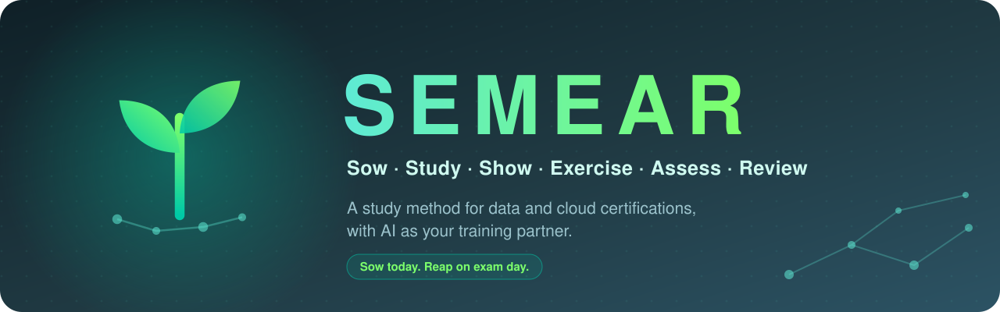
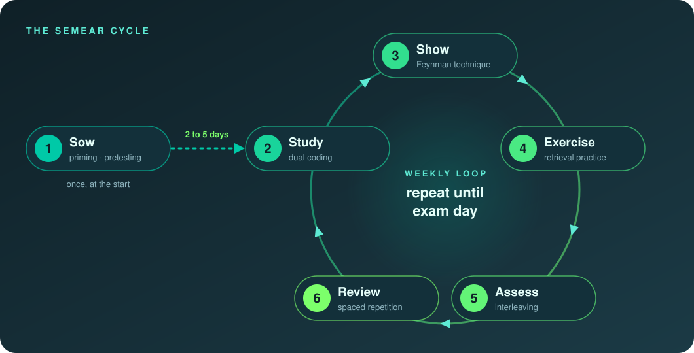

<div align="center">



<br />


<br /><br />

**Most people prepare for certifications by rereading and highlighting.**<br />
Research says that is one of the weakest ways to remember anything.<br />
SEMEAR turns real cognitive science into a **simple weekly routine**, with AI as your training partner.

<br />

[**Method**](#-the-semear-method) · [**Quick start**](#-start-in-5-minutes) · [**Prompts**](#-ai-as-your-training-partner) · [**Certifications**](#-certifications) · [**Science**](#-backed-by-science) · [**Contributing**](#-contributing)

<br />

<a href="README.pt-BR.md"></a>

</div>


## 🌱 Why SEMEAR?

<table>
<tr>
<td width="60%">

I am **Gabriel (Gabs)**, a data engineer. I passed **AZ-900**, **DP-750**, **DP-800** and **Airflow** with this method and decided to document not only *what* to study, but **how** to study.

This repo is my **central study hub**: the method is the trunk and each certification is a branch. New exams plug in without changing the structure.

> *Semear* is Portuguese for **"to sow"**. The initials of the six steps spell the word:
> **S**emear, **E**studar, **M**ostrar, **E**xercitar, **A**valiar, **R**evisar.

</td>
<td width="40%">

**This is for you if:**

🎯 You are preparing for a **data or cloud cert**<br />
🧭 You are starting a **topic from zero**<br />
🔁 You studied before and **forgot everything**<br />
🤖 You want AI to **make you think**, not hand answers

</td>
</tr>
</table>


## 🔄 The SEMEAR method

Six steps. One runs once at the start, the other five repeat every week until exam day.

<div align="center">

</div>

<br />

<table>
<tr>
<td align="center" width="50"></td>
<td><strong>Sow</strong> <em>(Semear)</em></td>
<td>Skim everything about the topic without trying to understand it. Then pause <strong>2 to 5 days</strong>.</td>
<td><code>advance organizers</code> <code>pretesting effect</code></td>
</tr>
<tr>
<td align="center"></td>
<td><strong>Study</strong> <em>(Estudar)</em></td>
<td>Passive study in 30 to 60 min modules. Write <strong>3 lines</strong> per module.</td>
<td><code>encoding</code> <code>dual coding</code></td>
</tr>
<tr>
<td align="center"></td>
<td><strong>Show</strong> <em>(Mostrar)</em></td>
<td>Record yourself <strong>explaining out loud</strong>, as if teaching a class. Where you stall is where the gap is.</td>
<td><code>Feynman technique</code> <code>production effect</code></td>
</tr>
<tr>
<td align="center"></td>
<td><strong>Exercise</strong> <em>(Exercitar)</em></td>
<td>8 to 12 AI-generated questions per module. Log every mistake <strong>with its cause</strong>.</td>
<td><code>retrieval practice</code> <code>testing effect</code></td>
</tr>
<tr>
<td align="center"></td>
<td><strong>Assess</strong> <em>(Avaliar)</em></td>
<td>Weekly <strong>cumulative, shuffled</strong> mock exam covering the whole week plus earlier weeks.</td>
<td><code>interleaving</code> <code>cumulative testing</code></td>
</tr>
<tr>
<td align="center"></td>
<td><strong>Review</strong> <em>(Revisar)</em></td>
<td>10 to 15 min a day: re-listen to your audios and redo your mistakes at <strong>1, 3, 7, 14, 30 days</strong>.</td>
<td><code>spaced repetition</code> <code>distributed practice</code></td>
</tr>
</table>

> [!TIP]
> **Principle zero: find what keeps you consistent.** Research does not support rigid "learning styles"
> (visual, auditory...). Try several formats, **combine them**, and keep the one that makes you want to
> come back tomorrow. The active steps (Show, Exercise, Review) work for everyone.

📖 Full walkthrough: [`metodo/README.en.md`](metodo/README.en.md) · [Português](metodo/README.md)


## 📅 A week in practice

<table>
<tr>
<td align="center" width="80"><strong>Mon</strong></td>
<td>Study module 1 → Show (record the audio)</td>
</tr>
<tr>
<td align="center"><strong>Tue</strong></td>
<td>Exercise module 1 → Review</td>
</tr>
<tr>
<td align="center"><strong>Wed</strong></td>
<td>Study module 2 → Show</td>
</tr>
<tr>
<td align="center"><strong>Thu</strong></td>
<td>Exercise module 2 → Review</td>
</tr>
<tr>
<td align="center"><strong>Fri</strong></td>
<td>Re-listen to the week's audios + error log</td>
</tr>
<tr>
<td align="center"><strong>Sat</strong></td>
<td><strong>Assess:</strong> weekly mock exam</td>
</tr>
<tr>
<td align="center"><strong>Sun</strong></td>
<td>Analyze mistakes → plan next week</td>
</tr>
</table>

> [!IMPORTANT]
> **Golden rule:** a short daily review beats a weekend marathon.


## 🚀 Start in 5 minutes

**1.** Fork this repo and clone it

```bash
git clone https://github.com/GabrielHenriqueCA/semear.git && cd semear
```

**2.** Create your exam folder from the blank template <kbd>requires Node 18+</kbd>

```bash
npm run nova -- dp-203 "DP-203 | Azure Data Engineer Associate"
```

No Node? Just copy [`certificacoes/_modelo/`](certificacoes/_modelo/) and replace `{{TITULO}}`.

**3.** Plant the tutor: open a new chat with Claude (or any AI), paste the
[master tutor prompt](prompts/00-semear-tutor.en.md) and fill in the `[BRACKETED]` fields.
It asks at most 3 questions and builds your week by week schedule.

**4.** Build your week with [`templates/ciclo-semanal.en.md`](templates/ciclo-semanal.en.md) (or [pt-BR](templates/ciclo-semanal.md)).

**5.** Start your error log with [`templates/diario-de-erros.en.md`](templates/diario-de-erros.en.md) (or [pt-BR](templates/diario-de-erros.md)).
It is worth more than any summary.


## 🤖 AI as your training partner

The AI is not there to give you answers. It is there to **ask the right questions** at every step.

<table>
<tr>
<th>Step</th>
<th>How the AI helps</th>
<th>Prompt</th>
</tr>
<tr>
<td><strong>All</strong></td>
<td>Tutor that knows the whole method, with quick commands (<code>/show</code>, <code>/exercise</code>, <code>/review</code>...)</td>
<td><a href="prompts/00-semear-tutor.en.md"><code>tutor.en</code></a> · <a href="prompts/00-semear-tutor.pt-BR.md"><code>tutor.pt</code></a></td>
</tr>
<tr>
<td><strong>Sow</strong></td>
<td>Map of the topic + glossary of terms you will meet</td>
<td><em>(built into the tutor, <code>/sow</code>)</em></td>
</tr>
<tr>
<td><strong>Show</strong></td>
<td>Voice conversation: you explain, it questions you, one question at a time</td>
<td><a href="prompts/01-feynman-voz.en.md"><code>voice.en</code></a> · <a href="prompts/01-feynman-voz.pt-BR.md"><code>voice.pt</code></a></td>
</tr>
<tr>
<td><strong>Exercise</strong></td>
<td>10 exam-style questions with commented answers and error classification</td>
<td><a href="prompts/02-exercicios-modulo.en.md"><code>exercise.en</code></a> · <a href="prompts/02-exercicios-modulo.pt-BR.md"><code>exercise.pt</code></a></td>
</tr>
<tr>
<td><strong>Assess</strong></td>
<td>Cumulative shuffled mock exam, weighted by exam domains</td>
<td><a href="prompts/03-simulado-semanal.en.md"><code>mock.en</code></a> · <a href="prompts/03-simulado-semanal.pt-BR.md"><code>mock.pt</code></a></td>
</tr>
<tr>
<td><strong>Plan</strong></td>
<td>Realistic week by week schedule up to exam day</td>
<td><a href="prompts/04-plano-semanal.en.md"><code>plan.en</code></a> · <a href="prompts/04-plano-semanal.pt-BR.md"><code>plan.pt</code></a></td>
</tr>
</table>

> [!WARNING]
> **AI makes mistakes.** Always confirm doubtful answers in the official documentation
> (Microsoft Learn, Databricks docs, Airflow docs). One mistake you fixed with an official source
> is worth more than ten right answers confirmed only by AI.


## 🎓 Certifications

<table>
<tr>
<th>Exam</th>
<th>Name</th>
<th>Status</th>
<th>Credential</th>
<th>Folder</th>
</tr>
<tr>
<td> <strong>AZ-900</strong></td>
<td>Microsoft Azure Fundamentals</td>
<td></td>
<td><a href="https://learn.microsoft.com/pt-br/credentials/certifications/azure-fundamentals/"></a></td>
<td><a href="certificacoes/az-900/"><code>az-900/</code></a></td>
</tr>
<tr>
<td> <strong>DP-750</strong></td>
<td>Azure Databricks Data Engineer Associate</td>
<td></td>
<td><a href="https://learn.microsoft.com/api/credentials/share/pt-br/GabrielHenrique-6044/65C136C3B11C5706?sharingId"></a></td>
<td><a href="certificacoes/dp-750/"><code>dp-750/</code></a></td>
</tr>
<tr>
<td> <strong>DP-800</strong></td>
<td>Developing AI-Enabled Database Solutions</td>
<td></td>
<td><a href="https://learn.microsoft.com/credentials/certifications/developing-ai-enabled-database-solutions/"></a></td>
<td><a href="certificacoes/dp-800/"><code>dp-800/</code></a></td>
</tr>
<tr>
<td> <strong>Airflow</strong></td>
<td>Astronomer: Airflow 3 (Fundamentals & DAG Authoring) + AI Orchestration</td>
<td></td>
<td><a href="https://www.credly.com/earner/earned/badge/957e8750-f89e-4860-8074-a88385a4093e"></a></td>
<td><a href="certificacoes/airflow/"><code>airflow/</code></a></td>
</tr>
</table>

### 🧭 Roadmap: Upcoming Certifications

Certifications planned for future cycles with the SEMEAR method:

<table>
<tr>
<th>Exam</th>
<th>Track</th>
<th>Focus Areas</th>
<th>Target Status</th>
</tr>
<tr>
<td> <strong>DP-600</strong></td>
<td>Microsoft Fabric Analytics Engineer</td>
<td>Lakehouse architecture, Delta tables, semantic models, DAX</td>
<td></td>
</tr>
<tr>
<td> <strong>DEA-C01</strong></td>
<td>AWS Certified Data Engineer Associate</td>
<td>Glue, Athena, Redshift, EMR, Kinesis, Lake Formation</td>
<td></td>
</tr>
<tr>
<td> <strong>GenAI Engineer</strong></td>
<td>Databricks Generative AI Engineer Associate</td>
<td>LLMOps, Mosaic AI, vector search, compound AI systems</td>
<td></td>
</tr>
<tr>
<td> <strong>dbt Developer</strong></td>
<td>dbt Fundamentals / Certified Developer</td>
<td>Data modeling, jinja, tests, documentation, CI/CD pipelines</td>
<td></td>
</tr>
</table>

Every certification follows the **same template**, so you always know where to look:

```
certificacoes/<exam>/
├── README.md      overview, exam format, domains and weights, official links
├── plano.md       the SEMEAR schedule applied to that exam
├── resumos/       one file per domain or topic
├── erros.md       error log: what I got wrong and why
└── recursos.md    courses, docs, labs and mock exams I used
```

<details>
<summary><strong>📁 Full repository structure</strong></summary>

<br />

```
semear/
├── README.md · README.pt-BR.md
├── CONTRIBUTING.md · LICENSE · package.json
├── .github/           CI (link and style checks), issue and PR templates
├── assets/            logo, banners and diagrams
├── metodo/            the SEMEAR method in detail + scientific background
├── prompts/           ready-to-use prompts for Claude (or any AI)
├── scripts/           check.mjs (repo checks) · nova-certificacao.mjs (scaffolding)
├── templates/         weekly cycle, error log, explanation script
└── certificacoes/
    ├── _modelo/       blank template for new exams
    ├── az-900/        Azure Fundamentals
    ├── dp-750/        Azure Databricks Data Engineer
    ├── dp-800/        SQL AI Developer Associate
    └── airflow/       Airflow 3, DAG Authoring and AI Orchestration
```

</details>


## 🔬 Backed by science

Every step is grounded in real research. No invented studies: check the original sources.

<table>
<tr>
<th>Concept</th>
<th>Step</th>
<th>Reference</th>
</tr>
<tr><td>Advance organizers</td><td>Sow</td><td>Ausubel (1960)</td></tr>
<tr><td>Pretesting effect</td><td>Sow</td><td>Richland, Kornell & Kao (2009)</td></tr>
<tr><td>Production effect</td><td>Show</td><td>MacLeod et al. (2010)</td></tr>
<tr><td>Retrieval practice / testing effect</td><td>Exercise</td><td>Roediger & Karpicke (2006)</td></tr>
<tr><td>Interleaving</td><td>Assess</td><td>Kornell & Bjork (2008)</td></tr>
<tr><td>Forgetting curve</td><td>Review</td><td>Ebbinghaus (1885)</td></tr>
<tr><td>Distributed practice</td><td>Review</td><td>Cepeda et al. (2006)</td></tr>
<tr><td>Critique of "learning styles"</td><td>Principle zero</td><td>Pashler et al. (2008)</td></tr>
</table>

📚 Full list and reading suggestions: [`metodo/ciencia.md`](metodo/ciencia.md) ·
Recommended books: *Make It Stick* (Brown, Roediger, McDaniel) · *A Mind for Numbers* (Oakley)


## 🏡 House rules

> [!CAUTION]
> **No brain dumps.** No leaked real exam questions, ever. It violates the exam's confidentiality
> agreement, can get your certification revoked and teaches you nothing. Pull requests with that
> content will be closed.

- **AI-generated questions are practice, not the real exam.** Also use the official practice
  assessments from Microsoft and Databricks.
- **Always check the official exam guide.** Domains, weights and passing scores change over time.
  This repo complements the official guide, it does not replace it.
- **Cite the official source** for every technical fact.


## 🤝 Contributing

Found a mistake, have a tip, want to add a certification? Read [`CONTRIBUTING.md`](CONTRIBUTING.md).
Every contribution that helps the next person pass is welcome.

## 👤 Author

<table>
<tr>
<td>

**Gabriel Henrique (Gabs)**<br />
Data Engineer & Architecture | Wealth Management | Data Governance | Databricks, Spark & Airflow | Azure | Python, SQL & Salesforce

On the way to **Microsoft MVP** and **Databricks Champion**,<br />one person helped at a time.

<a href="https://www.linkedin.com/in/gabrielhenri/"></a>
<a href="https://github.com/GabrielHenriqueCA"></a>

</td>
</tr>
</table>

## 📄 License

[MIT](LICENSE). Use it, adapt it, share it. If it helped you pass, a ⭐ helps the next person find it.


<div align="center">


<br />
<strong><em>Sow today. Reap on exam day.</em></strong>

</div>
