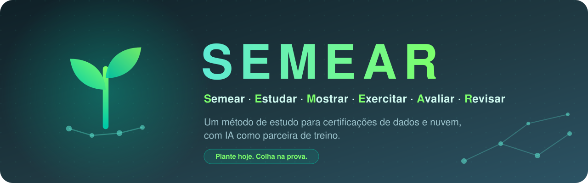
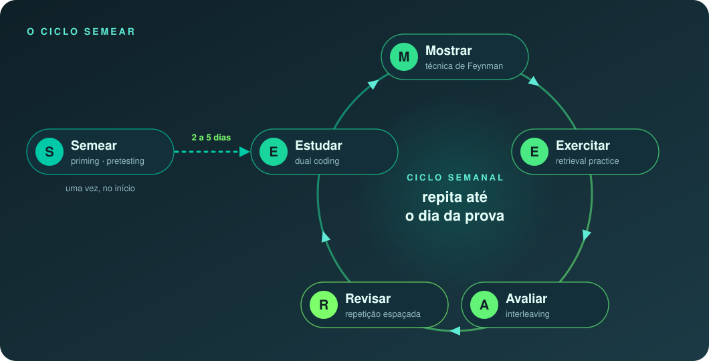

<div align="center">



<br />


<br /><br />

**A maioria das pessoas estuda para certificação relendo e grifando.**<br />
A pesquisa mostra que é uma das formas mais fracas de lembrar de algo.<br />
O SEMEAR transforma ciência cognitiva real em uma **rotina semanal simples**, com IA como parceira de treino.

<br />

[**Método**](#-o-método-semear) · [**Comece já**](#-comece-em-5-minutos) · [**Prompts**](#-a-ia-como-parceira-de-treino) · [**Certificações**](#-certificações) · [**Ciência**](#-base-científica) · [**Contribuir**](#-contribuindo)

<br />

<a href="README.md"></a>

</div>


## 🌱 Por que SEMEAR?

<table>
<tr>
<td width="60%">

Eu sou o **Gabriel (Gabs)**, engenheiro de dados. Passei na **AZ-900**, na **DP-750** e no **Airflow** com este método e resolvi documentar não só *o que* estudar, mas **como** estudar.

Este repo é o meu **hub central de estudo**: o método é o tronco e cada certificação é um galho. Novas provas entram sem mudar a estrutura.

> As iniciais das seis etapas formam a palavra:
> **S**emear, **E**studar, **M**ostrar, **E**xercitar, **A**valiar, **R**evisar.
> Fácil de lembrar no dia da prova.

</td>
<td width="40%">

**Para quem é:**

🎯 Preparando para uma **certificação de dados ou nuvem**<br />
🧭 Começando um **tema do zero**<br />
🔁 Estudou antes e **esqueceu tudo**<br />
🤖 Quer que a IA **te faça pensar**, não entregue pronto

</td>
</tr>
</table>


## 🔄 O método SEMEAR

Seis etapas. Uma acontece uma vez só, no início. As outras cinco se repetem toda semana até a prova.

<div align="center">

</div>

<br />

<table>
<tr>
<td align="center" width="50"></td>
<td><strong>Semear</strong></td>
<td>Passe o olho em tudo sobre o tema, sem cobrar entendimento. Depois, pause de <strong>2 a 5 dias</strong>.</td>
<td><code>advance organizers</code> <code>pretesting effect</code></td>
</tr>
<tr>
<td align="center"></td>
<td><strong>Estudar</strong></td>
<td>Estudo passivo em módulos de 30 a 60 min. Escreva <strong>3 linhas</strong> por módulo.</td>
<td><code>encoding</code> <code>dual coding</code></td>
</tr>
<tr>
<td align="center"></td>
<td><strong>Mostrar</strong></td>
<td>Grave um áudio <strong>explicando em voz alta</strong>, como numa aula. Onde travar, ali está a lacuna.</td>
<td><code>Técnica de Feynman</code> <code>efeito de produção</code></td>
</tr>
<tr>
<td align="center"></td>
<td><strong>Exercitar</strong></td>
<td>8 a 12 questões geradas com IA por módulo. Registre cada erro <strong>com a causa</strong>.</td>
<td><code>retrieval practice</code> <code>testing effect</code></td>
</tr>
<tr>
<td align="center"></td>
<td><strong>Avaliar</strong></td>
<td>Simulado semanal <strong>cumulativo e embaralhado</strong>, com a semana inteira e um pouco das anteriores.</td>
<td><code>interleaving</code> <code>teste cumulativo</code></td>
</tr>
<tr>
<td align="center"></td>
<td><strong>Revisar</strong></td>
<td>10 a 15 min por dia: reouça seus áudios e refaça seus erros em <strong>1, 3, 7, 14 e 30 dias</strong>.</td>
<td><code>repetição espaçada</code> <code>distributed practice</code></td>
</tr>
</table>

> [!TIP]
> **Princípio zero: descubra o que te mantém consistente.** A pesquisa não sustenta "estilos de
> aprendizagem" rígidos (visual, auditivo...). Teste formatos, **combine-os** e fique com o que te dá
> vontade de voltar amanhã. As etapas ativas (Mostrar, Exercitar, Revisar) valem para todo mundo.

📖 Passo a passo de cada etapa: [`metodo/README.md`](metodo/README.md)


## 📅 Uma semana na prática

<table>
<tr>
<td align="center" width="80"><strong>Seg</strong></td>
<td>Estudar módulo 1 → Mostrar (gravar o áudio)</td>
</tr>
<tr>
<td align="center"><strong>Ter</strong></td>
<td>Exercitar módulo 1 → Revisar</td>
</tr>
<tr>
<td align="center"><strong>Qua</strong></td>
<td>Estudar módulo 2 → Mostrar</td>
</tr>
<tr>
<td align="center"><strong>Qui</strong></td>
<td>Exercitar módulo 2 → Revisar</td>
</tr>
<tr>
<td align="center"><strong>Sex</strong></td>
<td>Reouvir os áudios da semana + diário de erros</td>
</tr>
<tr>
<td align="center"><strong>Sáb</strong></td>
<td><strong>Avaliar:</strong> simulado semanal</td>
</tr>
<tr>
<td align="center"><strong>Dom</strong></td>
<td>Analisar os erros → planejar a próxima semana</td>
</tr>
</table>

> [!IMPORTANT]
> **Regra de ouro:** revisão diária curta vale mais que uma maratona no fim de semana.


## 🚀 Comece em 5 minutos

**1.** Faça um fork deste repo e clone

```bash
git clone https://github.com/<seu-usuario>/semear.git && cd semear
```

**2.** Crie a pasta da sua prova a partir do molde em branco <kbd>requer Node 18+</kbd>

```bash
npm run nova -- dp-203 "DP-203 | Azure Data Engineer Associate"
```

Sem Node? Copie [`certificacoes/_modelo/`](certificacoes/_modelo/) e troque `{{TITULO}}`.

**3.** Plante o tutor: abra uma conversa nova com o Claude (ou outra IA), cole o
[prompt mestre do tutor](prompts/00-semear-tutor.pt-BR.md) e preencha os campos entre `[COLCHETES]`.
Ele faz no máximo 3 perguntas e monta o seu cronograma semana a semana.

**4.** Monte a sua semana com [`templates/ciclo-semanal.md`](templates/ciclo-semanal.md) (ou [versão em inglês](templates/ciclo-semanal.en.md)).

**5.** Comece o seu diário de erros com [`templates/diario-de-erros.md`](templates/diario-de-erros.md) (ou [versão em inglês](templates/diario-de-erros.en.md)).
Ele vale mais que qualquer resumo.


## 🤖 A IA como parceira de treino

A IA não está aqui para te dar respostas. Está aqui para **fazer as perguntas certas** em cada etapa.

<table>
<tr>
<th>Etapa</th>
<th>Como a IA ajuda</th>
<th>Prompt</th>
</tr>
<tr>
<td><strong>Todas</strong></td>
<td>Tutor que conhece o método inteiro, com comandos rápidos (<code>/mostrar</code>, <code>/exercitar</code>, <code>/revisar</code>...)</td>
<td><a href="prompts/00-semear-tutor.pt-BR.md"><code>tutor.pt</code></a> · <a href="prompts/00-semear-tutor.en.md"><code>tutor.en</code></a></td>
</tr>
<tr>
<td><strong>Semear</strong></td>
<td>Mapa do tema + glossário dos termos que vão aparecer</td>
<td><em>(dentro do tutor, <code>/semear</code>)</em></td>
</tr>
<tr>
<td><strong>Mostrar</strong></td>
<td>Conversa por voz: você explica, ela questiona, uma pergunta por vez</td>
<td><a href="prompts/01-feynman-voz.pt-BR.md"><code>voz.pt</code></a> · <a href="prompts/01-feynman-voz.en.md"><code>voz.en</code></a></td>
</tr>
<tr>
<td><strong>Exercitar</strong></td>
<td>10 questões no estilo da prova, com gabarito comentado e causa de cada erro</td>
<td><a href="prompts/02-exercicios-modulo.pt-BR.md"><code>exerc.pt</code></a> · <a href="prompts/02-exercicios-modulo.en.md"><code>exerc.en</code></a></td>
</tr>
<tr>
<td><strong>Avaliar</strong></td>
<td>Simulado cumulativo e embaralhado, respeitando os pesos dos domínios</td>
<td><a href="prompts/03-simulado-semanal.pt-BR.md"><code>mock.pt</code></a> · <a href="prompts/03-simulado-semanal.en.md"><code>mock.en</code></a></td>
</tr>
<tr>
<td><strong>Planejar</strong></td>
<td>Cronograma realista semana a semana até a prova</td>
<td><a href="prompts/04-plano-semanal.pt-BR.md"><code>plano.pt</code></a> · <a href="prompts/04-plano-semanal.en.md"><code>plano.en</code></a></td>
</tr>
</table>

> [!WARNING]
> **A IA erra.** Confirme respostas duvidosas na documentação oficial (Microsoft Learn, docs da
> Databricks, docs do Airflow). Um erro seu corrigido com fonte oficial vale mais que dez acertos
> confirmados só pela IA.


## 🎓 Certificações

<table>
<tr>
<th>Prova</th>
<th>Nome</th>
<th>Status</th>
<th>Credencial</th>
<th>Pasta</th>
</tr>
<tr>
<td> <strong>AZ-900</strong></td>
<td>Microsoft Azure Fundamentals</td>
<td></td>
<td><a href="https://learn.microsoft.com/pt-br/credentials/certifications/azure-fundamentals/"></a></td>
<td><a href="certificacoes/az-900/"><code>az-900/</code></a></td>
</tr>
<tr>
<td> <strong>DP-750</strong></td>
<td>Azure Databricks Data Engineer Associate</td>
<td></td>
<td><a href="https://learn.microsoft.com/api/credentials/share/pt-br/GabrielHenrique-6044/65C136C3B11C5706?sharingId"></a></td>
<td><a href="certificacoes/dp-750/"><code>dp-750/</code></a></td>
</tr>
<tr>
<td> <strong>Airflow</strong></td>
<td>Astronomer: Airflow 3 (Fundamentals & DAG Authoring) + AI Orchestration</td>
<td></td>
<td><a href="https://www.credly.com/earner/earned/badge/957e8750-f89e-4860-8074-a88385a4093e"></a></td>
<td><a href="certificacoes/airflow/"><code>airflow/</code></a></td>
</tr>
</table>

### 🧭 Roadmap: Próximas Certificações

Certificações planejadas para os próximos ciclos de estudo com o método SEMEAR:

<table>
<tr>
<th>Exame</th>
<th>Trilha</th>
<th>Foco Principal</th>
<th>Status Previsto</th>
</tr>
<tr>
<td> <strong>DP-600</strong></td>
<td>Microsoft Fabric Analytics Engineer</td>
<td>Arquitetura lakehouse, tabelas Delta, modelos semânticos, DAX</td>
<td></td>
</tr>
<tr>
<td> <strong>DEA-C01</strong></td>
<td>AWS Certified Data Engineer Associate</td>
<td>Glue, Athena, Redshift, EMR, Kinesis, Lake Formation</td>
<td></td>
</tr>
<tr>
<td> <strong>GenAI Engineer</strong></td>
<td>Databricks Generative AI Engineer Associate</td>
<td>LLMOps, Mosaic AI, busca vetorial, sistemas compostos de IA</td>
<td></td>
</tr>
<tr>
<td> <strong>dbt Developer</strong></td>
<td>dbt Fundamentals / Certified Developer</td>
<td>Modelagem de dados, jinja, testes, documentação, pipelines de CI/CD</td>
<td></td>
</tr>
</table>

Toda certificação segue o **mesmo molde**, então você sempre sabe onde procurar:

```
certificacoes/<prova>/
├── README.md      visão geral, formato da prova, domínios e pesos, links oficiais
├── plano.md       o cronograma SEMEAR aplicado àquela prova
├── resumos/       um arquivo por domínio ou tópico
├── erros.md       diário de erros: o que errei e por quê
└── recursos.md    cursos, docs, labs e simulados que usei
```

<details>
<summary><strong>📁 Estrutura completa do repositório</strong></summary>

<br />

```
semear/
├── README.md · README.pt-BR.md
├── CONTRIBUTING.md · LICENSE · package.json
├── .github/           CI (checagem de links e estilo), modelos de issue e PR
├── assets/            logo, banners e diagramas
├── metodo/            o método SEMEAR em detalhe + base científica
├── prompts/           prompts prontos para usar com Claude (ou outra IA)
├── scripts/           check.mjs (checagens do repo) · nova-certificacao.mjs (scaffolding)
├── templates/         ciclo semanal, diário de erros, roteiro de explicação
└── certificacoes/
    ├── _modelo/       molde em branco para novas provas
    ├── az-900/        Azure Fundamentals
    ├── dp-750/        Azure Databricks Data Engineer
    └── airflow/       Airflow 3, Autoria de DAGs e Orquestração de IA
```

</details>


## 🔬 Base científica

Cada etapa tem base em pesquisa real. Nenhum estudo inventado: confira as fontes originais.

<table>
<tr>
<th>Conceito</th>
<th>Etapa</th>
<th>Referência</th>
</tr>
<tr><td>Advance organizers</td><td>Semear</td><td>Ausubel (1960)</td></tr>
<tr><td>Pretesting effect</td><td>Semear</td><td>Richland, Kornell & Kao (2009)</td></tr>
<tr><td>Production effect</td><td>Mostrar</td><td>MacLeod et al. (2010)</td></tr>
<tr><td>Retrieval practice / testing effect</td><td>Exercitar</td><td>Roediger & Karpicke (2006)</td></tr>
<tr><td>Interleaving</td><td>Avaliar</td><td>Kornell & Bjork (2008)</td></tr>
<tr><td>Curva do esquecimento</td><td>Revisar</td><td>Ebbinghaus (1885)</td></tr>
<tr><td>Distributed practice</td><td>Revisar</td><td>Cepeda et al. (2006)</td></tr>
<tr><td>Críticas a "estilos de aprendizagem"</td><td>Princípio zero</td><td>Pashler et al. (2008)</td></tr>
</table>

📚 Lista completa e sugestões de leitura: [`metodo/ciencia.md`](metodo/ciencia.md) ·
Livros recomendados: *Make It Stick* (Brown, Roediger, McDaniel) · *A Mind for Numbers* (Oakley)


## 🏡 Regras da casa

> [!CAUTION]
> **Sem brain dumps.** Nada de questões reais vazadas da prova, nunca. Isso viola o acordo de
> confidencialidade do exame, pode custar a sua certificação e não te ensina nada. Pull requests com
> esse tipo de conteúdo serão fechados.

- **Questões geradas por IA são treino, não a prova real.** Use também os *practice assessments*
  oficiais da Microsoft e da Databricks.
- **Confira sempre o guia oficial da prova.** Domínios, pesos e nota de corte mudam com o tempo.
  Este repo complementa o guia oficial, não substitui.
- **Cite a fonte oficial** em qualquer fato técnico.


## 🤝 Contribuindo

Achou um erro, tem uma dica, quer adicionar uma certificação? Leia o [`CONTRIBUTING.md`](CONTRIBUTING.md).
Toda contribuição que ajude a próxima pessoa a passar é bem-vinda.

## 👤 Autor

<table>
<tr>
<td>

**Gabriel Henrique (Gabs)**<br />
Data Engineer & Architecture | Wealth Management | Data Governance | Databricks, Spark & Airflow | Azure | Python, SQL & Salesforce

A caminho de **Microsoft MVP** e **Databricks Champion**,<br />ajudando uma pessoa de cada vez.

<a href="https://www.linkedin.com/in/gabrielhenri/"></a>
<a href="https://github.com/GabrielHenriqueCA"></a>

</td>
</tr>
</table>

## 📄 Licença

[MIT](LICENSE). Use, adapte, compartilhe. Se te ajudou a passar, uma ⭐ ajuda a próxima pessoa a encontrar.


<div align="center">


<br />
<strong><em>Plante hoje. Colha na prova.</em></strong>

</div>
