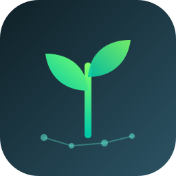

  

  

[**Recursos Oficiais**](recursos.md) · [**Simulado de Treino**](simulado.md) · [**Plano de Estudos**](plano.md) · [**Diário de Erros**](erros.md) · [**Resumo por Domínio**](resumos/resumo-completo.md)

## 🏆 Credenciais Conquistadas

<table>
<tr>
<th width="45%">Exame Oficial Astronomer</th>
<th width="35%">Credencial / Badge</th>
<th width="20%" align="center">Verificação</th>
</tr>
<tr>
<td><strong>Apache Airflow 3 Fundamentals</strong></td>
<td>Conceitos centrais, arquitetura, operadores e agendamento</td>
<td align="center"></td>
</tr>
<tr>
<td><strong>Apache Airflow 3 DAG Authoring</strong></td>
<td>TaskFlow API, Dynamic Task Mapping, Datasets e dependências</td>
<td align="center"></td>
</tr>
<tr>
<td><strong>AI Orchestration Fundamentals</strong></td>
<td>Workflows de IA, multi-agent systems, tool calling seguro e HITL</td>
<td align="center"></td>
</tr>
</table>

## 📋 Visão Geral dos Exames

- **Provedor:** Astronomer (empresa líder por trás do ecossistema comercial do Airflow).
- **Formato:** Provas objetivas com questões de múltipla escolha e cenários de código.
- **Preparação Gratuita:** [Astronomer Academy](https://academy.astronomer.io/).
- **Ferramenta Recomendada:** [Astro CLI](https://www.astronomer.io/docs/astro/cli/overview) para rodar o ambiente completo com Docker localmente.

## 🎯 Domínios de Conhecimento Cobrados

<table>
<tr>
<th width="40%">Domínio</th>
<th width="35%">Tópicos Centrais</th>
<th width="25%">Importância</th>
</tr>
<tr>
<td><strong>DAG Authoring & Scheduling</strong></td>
<td>Cron expressions, catchup, Timetables, Datasets / Assets</td>
<td></td>
</tr>
<tr>
<td><strong>TaskFlow API & Operators</strong></td>
<td>Decoradores <code>@task</code> e <code>@dag</code>, Dynamic Task Mapping (<code>expand</code>)</td>
<td></td>
</tr>
<tr>
<td><strong>Comunicação & Metadados</strong></td>
<td>XComs (limites e boas práticas), Connections, Variables, Pools</td>
<td></td>
</tr>
<tr>
<td><strong>Arquitetura & Execução</strong></td>
<td>Scheduler, Webserver, Triggerer (async), Workers, Celery vs K8s</td>
<td></td>
</tr>
<tr>
<td><strong>AI Orchestration</strong></td>
<td>Agentes autônomos, Human-in-the-Loop, Context Engineering</td>
<td></td>
</tr>
</table>

## 🧠 Tópicos Críticos para o Sucesso

### 1. Boas Práticas de Top-Level Code
- O Scheduler processa periodicamente arquivos de DAG a cada poucos segundos.
- **Nunca** coloque queries lentas a bancos, chamadas de API externa ou I/O pesado fora das tasks (no escopo global do arquivo Python). Isso degrada todo o cluster do Airflow.

### 2. TaskFlow API vs Operators Legados
- A TaskFlow API com `@task` permite escrever código idiomático em Python puro.
- O retorno de uma task passa a ser automaticamente empacotado como XCom e entregue como parâmetro para a task seguinte sem necessidade de chamar `xcom_push` e `xcom_pull` explicitamente.

### 3. Data-Aware Scheduling com Datasets
- Substitui horários fixos de cron por pipelines orientados a dados.
- Uma DAG de ingestão declara `outlets=[Dataset("s3://bucket/raw")]` e a DAG de transformação roda automaticamente com `schedule=[Dataset("s3://bucket/raw")]`.

### 4. Sensores e o Serviço Triggerer
- Sensores no modo `poke` mantêm a thread do worker presa e consumindo recursos.
- Sensores adiáveis (*deferrable operators*) e modo `reschedule` liberam o slot do worker para outras tarefas enquanto esperam eventos externos.

## 💡 Dicas de Ouro para o Dia da Prova

1. **Top-level code é o erro mais comum:** Qualquer I/O pesado no escopo global do arquivo `.py` (chamadas HTTP, queries a banco) será executado repetidamente pelo Scheduler a cada parsing cycle, degradando todo o cluster.
2. **XCom tem limite de tamanho:** O XCom padrão armazena dados no metastore (PostgreSQL). Nunca passe DataFrames grandes via XCom; grave no storage externo e passe apenas o caminho.
3. **`start_date` não é o momento do disparo:** Uma DAG `@daily` com `start_date=2026-09-01` só dispara em `2026-09-02 00:00:00`, após o *data interval* completo. Confusão frequente em provas.

## 📂 Arquivos Desta Pasta

- [recursos.md](recursos.md): Links para os cursos da Astronomer Academy e comandos do Astro CLI.
- [simulado.md](simulado.md): 10 questões práticas comentadas com gabarito interativo.
- [plano.md](plano.md): Cronograma SEMEAR para passar nas certificações da Astronomer.
- [erros.md](erros.md): Diário de erros com análise das principais armadilhas de código.
- [resumos/resumo-completo.md](resumos/resumo-completo.md): Guia de sintaxe e arquitetura de referência.

 
<strong><em>Plante hoje. Domine a orquestração de dados e IA na prova.</em></strong>

