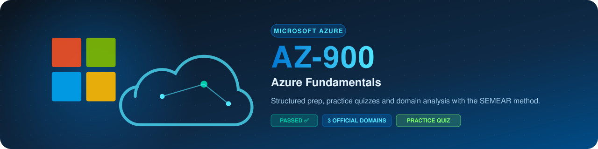

  

  

[**Recursos Oficiais**](recursos.md) · [**Simulado de Treino**](simulado.md) · [**Plano de Estudos**](plano.md) · [**Diário de Erros**](erros.md) · [**Resumo por Domínio**](resumos/resumo-completo.md)

## 📋 Visão Geral da Prova

<table>
<tr>
<th width="30%">Item</th>
<th width="70%">Detalhe Oficial</th>
</tr>
<tr>
<td><strong>Página oficial</strong></td>
<td><a href="https://learn.microsoft.com/en-us/credentials/certifications/azure-fundamentals/">Microsoft Learn: AZ-900</a></td>
</tr>
<tr>
<td><strong>Duração</strong></td>
<td>45 minutos (tempo de tela de prova)</td>
</tr>
<tr>
<td><strong>Quantidade de questões</strong></td>
<td>35 a 50 questões (múltipla escolha, arrastar e soltar, hot area)</td>
</tr>
<tr>
<td><strong>Nota de corte</strong></td>
<td>700 / 1000 pontos (aprox. 70%)</td>
</tr>
<tr>
<td><strong>Idiomas</strong></td>
<td>Português (Brasil), Inglês, Espanhol, entre outros</td>
</tr>
<tr>
<td><strong>Pré-requisitos</strong></td>
<td>Nenhum pré-requisito formal (porta de entrada para a nuvem Microsoft)</td>
</tr>
</table>

> [!NOTE]
> Esta prova avalia **compreensão conceitual** e raciocínio de negócio em nuvem, não exige memorização de comandos de CLI nem telas de configuração avançada do portal.

## 🎯 Domínios e Distribuição de Pesos

<table>
<tr>
<th width="50%">Domínio Oficial</th>
<th width="20%" align="center">Peso no Exame</th>
<th width="30%">Foco de Estudo</th>
</tr>
<tr>
<td><strong>1. Describe Cloud Concepts</strong></td>
<td align="center"></td>
<td>IaaS vs PaaS vs SaaS, CapEx vs OpEx, Responsabilidade Compartilhada</td>
</tr>
<tr>
<td><strong>2. Describe Azure Architecture and Services</strong></td>
<td align="center"></td>
<td>Regiões, Zonas de Disponibilidade, Compute, Storage, Networking, SQL</td>
</tr>
<tr>
<td><strong>3. Describe Azure Management and Governance</strong></td>
<td align="center"></td>
<td>Microsoft Entra ID, RBAC, Azure Policy, Locks, Cost Management</td>
</tr>
</table>

## 🧠 Tópicos Críticos por Domínio

### 1. Cloud Concepts (25 a 30%)
- **Modelo de Responsabilidade Compartilhada:** Saber exatamente o que é responsabilidade do cliente versus da Microsoft em IaaS, PaaS e SaaS.
- **Modelos de Nuvem:** Pública, Privada e Híbrida (cenários híbridos com Azure Arc).
- **Modelos Econômicos:** CapEx (investimento inicial em hardware) vs OpEx (gasto operacional contínuo sob demanda).
- **Atributos de Nuvem:** Alta disponibilidade, escalabilidade (vertical vs horizontal), elasticidade, agilidade e recuperação de desastres.

### 2. Azure Architecture & Services (35 a 40%)
- **Estrutura Geográfica:** Regiões Azure, Pares de Regiões (Region Pairs) para recuperação e Zonas de Disponibilidade (Availability Zones com datacenters isolados).
- **Hierarquia de Recursos:** Management Groups > Subscriptions > Resource Groups > Resources.
- **Serviços de Compute:** Virtual Machines (IaaS), App Services (PaaS), Azure Functions (Serverless), AKS e Container Instances.
- **Armazenamento:** Azure Blob Storage (camadas Hot, Cool, Cold, Archive), Azure Files (SMB/NFS) e redundâncias (LRS, ZRS, GRS).
- **Networking:** Virtual Networks (VNets), Subnets, VPN Gateway, ExpressRoute e Network Security Groups (NSG).

### 3. Management & Governance (30 a 35%)
- **Identidade e Segurança:** Microsoft Entra ID (antigo Azure AD), autenticação multifator (MFA), Acesso Condicional e RBAC (Role-Based Access Control).
- **Governança:** Azure Policy (imposição de regras organizacionais) vs Locks (ReadOnly e CanNotDelete).
- **Monitoramento e Suporte:** Azure Monitor, Log Analytics, Azure Advisor e Azure Service Health.
- **Gestão de Custos:** Calculadora de Preços (estimativa prévia), Calculadora de TCO e Microsoft Cost Management.

## 💡 Dicas de Ouro para o Dia da Prova

1. **A pegadinha clássica de Governança:** *Azure Policy* impõe conformidade (ex: impedir criação de recursos fora do Brasil); *RBAC* controla quem tem permissão para realizar ações; *Resource Locks* evitam alterações ou exclusões acidentais.
2. **Availability Zones vs Region Pairs:** Zonas de Disponibilidade protegem contra falhas de datacenter individual dentro da mesma região. Pares de regiões protegem contra desastres geográficos em larga escala (distância mínima de 480 km).
3. **Archive Storage:** É a camada mais barata para armazenar dados raramente acessados, mas a reidratação de dados pode levar horas.

## 📂 Arquivos Desta Pasta

- [recursos.md](recursos.md): Links oficiais gratuitos no Microsoft Learn e simulados.
- [simulado.md](simulado.md): 10 questões práticas autorais comentadas com gabarito retrátil.
- [plano.md](plano.md): Roteiro semanal de estudos aplicando o ciclo SEMEAR.
- [erros.md](erros.md): Diário de erros com análise das pegadinhas mais comuns.
- [resumos/resumo-completo.md](resumos/resumo-completo.md): Resumo consolidado de alta retenção.

 
<strong><em>Plante hoje. Domine os fundamentos do Azure na prova.</em></strong>

