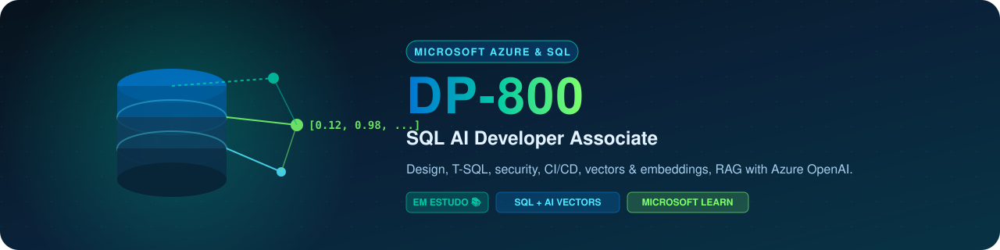

  

  

[**Recursos Oficiais**](recursos.md) · [**Simulado de Treino**](simulado.md) · [**Plano de Estudos**](plano.md) · [**Diário de Erros**](erros.md) · [**Resumo por Domínio**](resumos/resumo-completo.md)

## 📋 Visão Geral da Prova

<table>
<tr>
<th width="30%">Item</th>
<th width="70%">Detalhe Oficial</th>
</tr>
<tr>
<td><strong>Página oficial</strong></td>
<td><a href="https://learn.microsoft.com/credentials/certifications/developing-ai-enabled-database-solutions/">Microsoft Learn: DP-800</a></td>
</tr>
<tr>
<td><strong>Certificação</strong></td>
<td>Microsoft Certified: SQL AI Developer Associate</td>
</tr>
<tr>
<td><strong>Nota de corte</strong></td>
<td>700 / 1000 pontos</td>
</tr>
<tr>
<td><strong>Foco principal</strong></td>
<td>Design de bancos de dados, T-SQL, indexação, segurança, CI/CD, vetores e embeddings, RAG com Azure OpenAI e IA integrada ao SQL</td>
</tr>
<tr>
<td><strong>Pré-requisitos recomendados</strong></td>
<td>Experiência prática com SQL Server, Azure SQL, Fabric SQL, design de schemas e noções de IA generativa</td>
</tr>
</table>

## 🎯 Domínios e Distribuição de Pesos

<table>
<tr>
<th width="50%">Domínio Oficial</th>
<th width="20%" align="center">Peso no Exame</th>
<th width="30%">Foco de Estudo</th>
</tr>
<tr>
<td><strong>1. Design and develop database solutions</strong></td>
<td align="center"></td>
<td>Schemas, tabelas temporais, ledger tables, graph DB, in-memory, indexação rowstore/columnstore, JSON</td>
</tr>
<tr>
<td><strong>2. Secure, optimize, and deploy database solutions</strong></td>
<td align="center"></td>
<td>Segurança, compliance, tuning de performance, planos de execução, CI/CD com GitHub</td>
</tr>
<tr>
<td><strong>3. Implement AI capabilities in SQL solutions</strong></td>
<td align="center"></td>
<td>Embeddings, vetores, busca vetorial, RAG, Azure OpenAI, funções T-SQL de IA</td>
</tr>
</table>

## 🧠 Tópicos Críticos por Domínio

### 1. Design & Desenvolvimento de Soluções de Banco de Dados (35 a 40%)
- **Tabelas Especializadas:** Temporal tables (versionamento automático de linhas), Ledger tables (auditoria imutável com blockchain), Graph databases (nós e arestas para dados relacionais complexos) e In-memory OLTP (tabelas otimizadas para memória com latência ultra-baixa).
- **Indexação Estratégica:** Rowstore indexes (B-tree tradicional para OLTP) versus Columnstore indexes (compressão colunar para workloads analíticos e data warehousing).
- **JSON no SQL:** Armazenamento, consulta com `OPENJSON`, `JSON_VALUE`, `JSON_QUERY` e indexação de propriedades JSON para performance.
- **External Tables:** Virtualização de dados de fontes externas sem movimentação via PolyBase ou Elastic Query.

### 2. Segurança, Otimização e Deploy (35 a 40%)
- **Segurança em Camadas:** Row-Level Security (RLS), Dynamic Data Masking, Always Encrypted e Transparent Data Encryption (TDE).
- **Performance Tuning:** Análise de planos de execução, Query Store para regressões de performance, Automatic Tuning e estatísticas atualizadas.
- **CI/CD para Bancos de Dados:** Pipelines automatizados com GitHub Actions, Database Projects (`.sqlproj`), DACPAC/BACPAC e migrations versionadas.
- **Monitoramento:** DMVs (Dynamic Management Views), Extended Events e Azure Monitor para diagnóstico de gargalos.

### 3. Capacidades de IA em Soluções SQL (25 a 30%)
- **Vetores e Embeddings:** Tipo de dado `vector` nativo no SQL, geração de embeddings via modelos de IA e armazenamento direto em colunas vetoriais.
- **Busca Vetorial:** Operações de similaridade (cosine similarity, dot product) diretamente no T-SQL para cenários de busca semântica.
- **RAG (Retrieval-Augmented Generation):** Integração de dados do banco com Azure OpenAI para respostas contextualizadas: o banco como fonte de verdade para o LLM.
- **Funções T-SQL de IA:** Extensões nativas para invocar modelos de IA diretamente de dentro de queries SQL, sem precisar sair do banco.

## 💡 Dicas de Ouro para o Dia da Prova

1. **Temporal vs Ledger Tables:** Temporal tables rastreiam mudanças ao longo do tempo (versões de linha). Ledger tables fornecem uma trilha de auditoria criptograficamente verificável. Entenda quando usar cada uma.
2. **Rowstore vs Columnstore:** Use Rowstore para OLTP com muitas escritas pontuais. Use Columnstore para queries analíticas em grandes volumes com agregações. Saiba que uma tabela pode ter ambos (Clustered Columnstore + Nonclustered Rowstore).
3. **RAG não é fine-tuning:** RAG usa o banco de dados como contexto em tempo de consulta para o LLM. Fine-tuning altera o próprio modelo. A prova vai testar se você sabe diferenciar.
4. **CI/CD com DACPAC:** DACPAC é um snapshot do schema. Na publicação, ele compara o schema alvo com o atual e gera o script de diferença (diff). Cuidado com `DROP` acidental em objetos que existem no destino mas não no DACPAC.

## 📂 Arquivos Desta Pasta

- [recursos.md](recursos.md): Guias oficiais da Microsoft e trilhas de aprendizado.
- [simulado.md](simulado.md): 10 questões práticas avançadas comentadas com gabarito retrátil.
- [plano.md](plano.md): Roteiro estruturado de preparação para SQL + IA.
- [erros.md](erros.md): Diário de erros com análise das principais armadilhas de prova.
- [resumos/resumo-completo.md](resumos/resumo-completo.md): Guia de referência técnica rápida.

 
<strong><em>Plante hoje. Colha alto com SQL + IA na prova.</em></strong>

